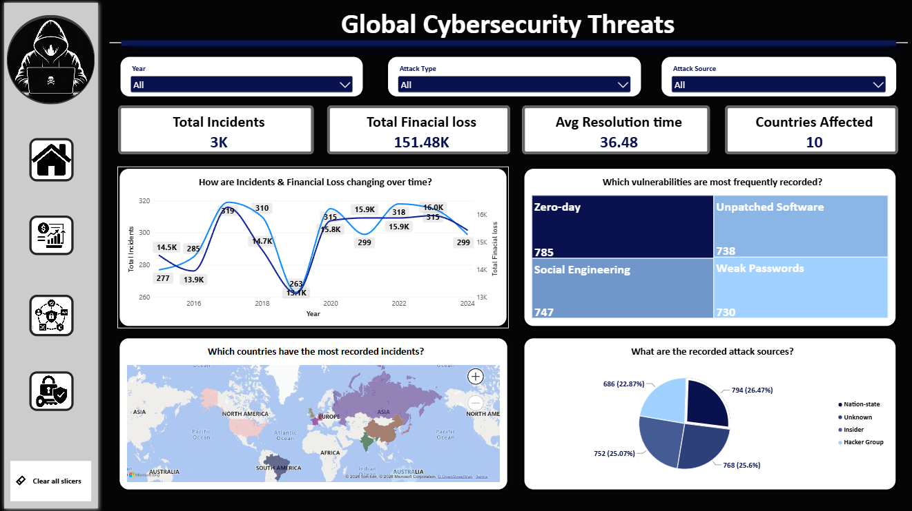
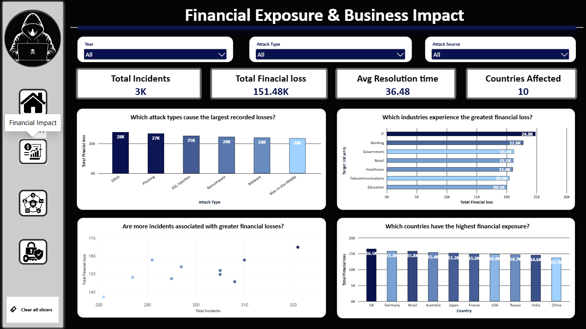
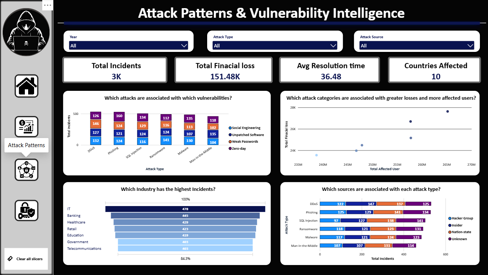
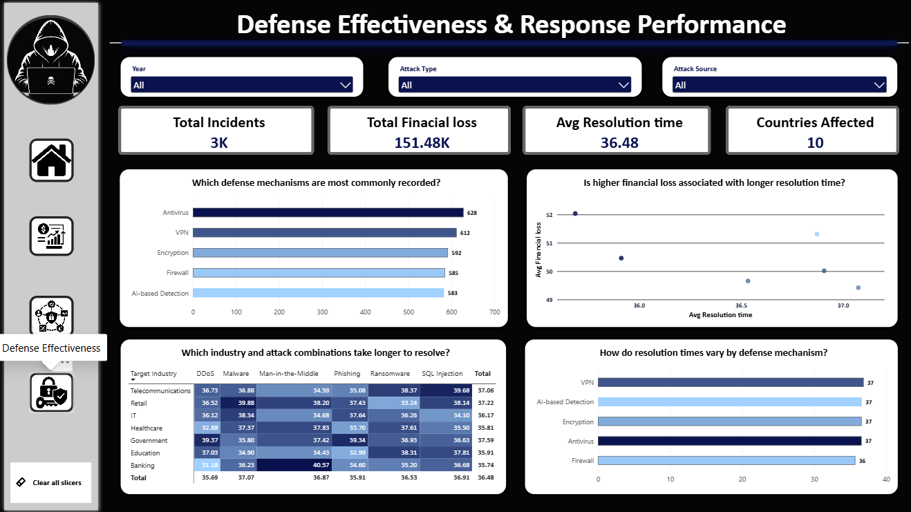

# 🌐 Global Cyber Threats Analytics Dashboard

## 📌 Project Overview

The Global Cyber Threats Analytics Dashboard is an interactive Power BI project that analyzes cybersecurity incidents from 2015 to 2024.

## 🎯 Project Objectives

- Analyze global cybersecurity incident trends.
- Identify the most common cyberattack types.
- Understand which industries are most targeted.
- Compare cybersecurity incidents across countries.
- Analyze financial losses caused by cyberattacks.
- Understand incident resolution time.

## 🛠️ Tools & Technologies

- Power BI Desktop
- Power Query
- DAX
- Microsoft Excel
- Data Visualization
- Data Cleaning and Transformation

## 📂 Dataset Information

**Dataset:** Global Cybersecurity Threats (2015–2024)

**Source:** Kaggle (https://www.kaggle.com/datasets/atharvasoundankar/global-cybersecurity-threats-2015-2024)

## 📊 Dashboard Analysis

### Page 1. Global Cyber Threats Overview

**Objective:** Provides an overview of global cybersecurity incidents, financial losses, vulnerabilities, and attack sources.

**Key Analysis:**
- Incident & Financial Loss Trend - Identify years with the highest incidents and financial losses, and describe the overall trend.
- Country Incident Ranking - Identifies countries with the highest recorded incidents.
- Vulnerability Distribution - Identify the most frequently recorded vulnerability categories.
- Attack Sources - Highlight the most frequently recorded attack sources.

## 📸 Dashboard Screenshots : 

### 2. Financial Exposure & Business Impact

**Objective:** To analyze the financial impact of cyberattacks across attack categories, industries, and countries.

**Key Analysis:**
- Financial Loss by Attack Type - Identify the attack type associated with the highest financial loss.
- Incidents vs Financial Loss - Explain whether countries or categories with more incidents also tend to show higher losses.
- Financial Loss by Industry - Identifies industries with the highest financial exposure.
- Country Financial Exposure - Identify countries with the largest recorded financial losses.

## 📸 Dashboard Screenshots : 

### 3. Attack Patterns & Vulnerability Intelligence

**Objective:** To understand relationships between attack types, vulnerabilities, targeted industries, and attack sources.

**Key Analysis:**
- Attack Type vs Vulnerability - Highlight the most frequently observed attack–vulnerability combinations.
- Incidents by Industry - Identify the most frequently targeted industry.
- Attack Categories Analysis - Highlight attack categories with higher recorded financial losses and affected users.
- Attack Sources by Type - Describe the most frequently recorded sources for different attack types.

## 📸 Dashboard Screenshots: 
 

### 4. Defense Effectiveness & Response Performance

**Objective:** To examine recorded defense mechanisms and analyze how resolution times vary across industries, attack combinations, and defense categories.

**Key Analysis:**
- Defense Mechanism Distribution - Identify the most frequently recorded defense mechanism.
- Resolution Time by Industry and Attack - Highlight combinations with the longest average resolution time.
- Financial Loss vs Resolution Time - Explain whether higher-loss incidents tend to have longer resolution times.
- Resolution Time by Defense Mechanism - Compare average resolution times across recorded defense mechanisms.

## 📸 Dashboard Screenshots : 

## 💡 Key Insights

- Identified the most frequently recorded cyberattack types.
- Compared cybersecurity incident volumes across countries.
- Identified highly targeted industries.
- Analyzed the financial impact of cyber incidents.
- Examined incident resolution time.

## 📁 Project Files

- Power BI dashboard (.pbix)
- Dashboard screenshots
- Dataset source information

## 🚀 How to Use

1. Install Power BI Desktop.
2. Download the Power BI (.pbix) file.
3. Open the downloaded PBIX file.
4. Explore the dashboard using filters and slicers.

## 🎯 Conclusion

Global Cyber Threats Analytics will provide a concise, interactive view of global cybersecurity
incidents from 2015–2024 by connecting threat frequency with impact, vulnerability. The project will demonstrate how raw cybersecurity data is transformed into an informative Power BI solution for analytical exploration and data-driven decision-making.

## 📌 Note

Insights represent the information recorded in the source dataset and not as a complete measure of real-world global cybersecurity activity.
